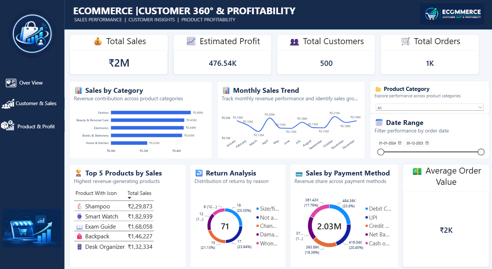
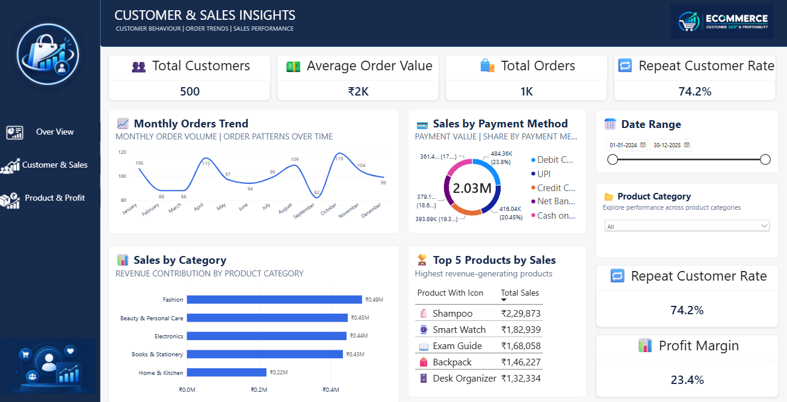
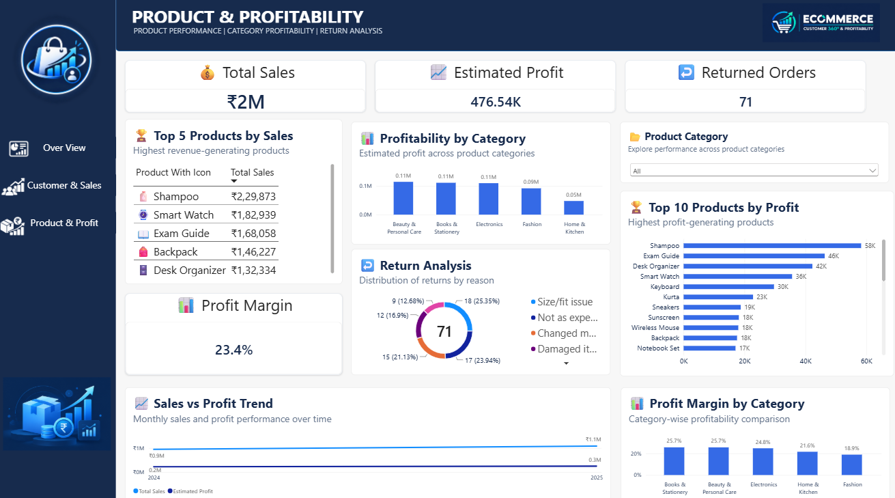

# E-commerce Analytics Dashboard

## About My Project
This is a practice project. I used sample e-commerce data to practise SQL Server and Power BI.

The data is synthetic, which means it was made for practice. It is not real data from Flipkart or any other company.

## Tools Used
- SQL Server
- Power BI
- CSV files

## Data Files
- `customers.csv` — customer details
- `orders.csv` — order details
- `order_items.csv` — products in orders, quantity, price, and cost
- `products.csv` — product names and groups
- `payments.csv` — payment methods and amounts
- `returns.csv` — returned orders and reasons
- `data_dictionary.csv` — explains the columns in the files

## What I Did
1. Reviewed the CSV files.
2. Used SQL to analyse sales, orders, customers, payments, and products.
3. Used IDs such as `customer_id`, `order_id`, and `product_id` to understand how the files connect.
4. Created a three-page dashboard in Power BI.
5. Added KPI cards, charts, and filters to make the results easy to explore.

## Dashboard Pages
- **Overview:** sales, estimated profit, customers, orders, and sales trends.
- **Customer & Sales Insights:** order trends, payment methods, and repeat customers.
- **Product & Profitability:** product sales, estimated profit, profit margin, and returns.
- ## Dashboard Screenshots

### 1. Executive Overview

### 2. Customer & Sales Insights

### 3. Product & Profitability

## Business Insights
- **Sales trend:** Identify months with higher or lower sales.
- **Product groups:** Compare groups to see which contribute more to sales.
- **Top products:** Find products with higher sales or estimated profit.
- **Customer behaviour:** Check how many customers place more than one order.
- **Payments and returns:** Compare payment methods and review common return reasons.

## Profit Note
Estimated profit = item sales - (quantity × item cost).

This is only an estimate. It does not include delivery, tax, or other business costs. The sample payment amounts may also be a little different from item totals.

## What I Learned
I practised SQL queries, learned how data files connect, explored business metrics, and created a dashboard in Power BI.
